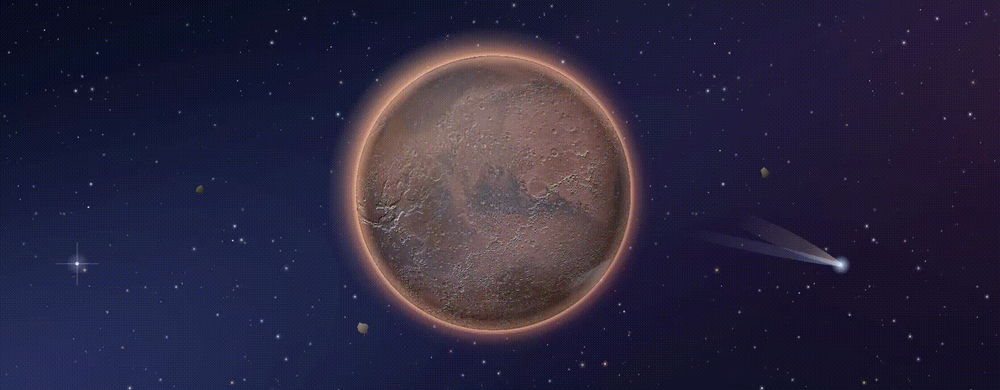
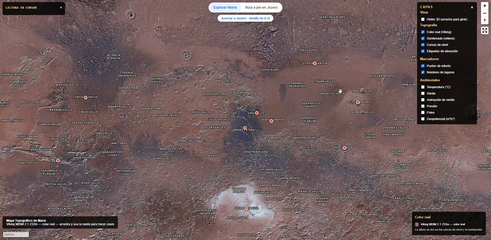
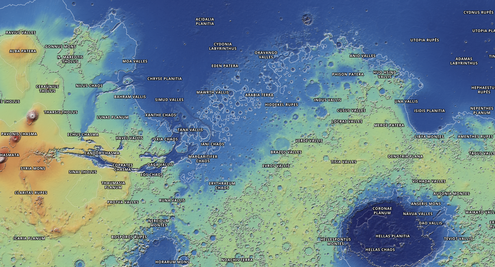
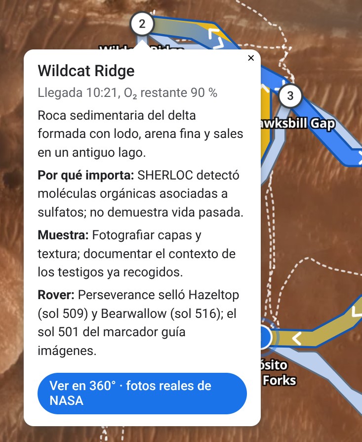
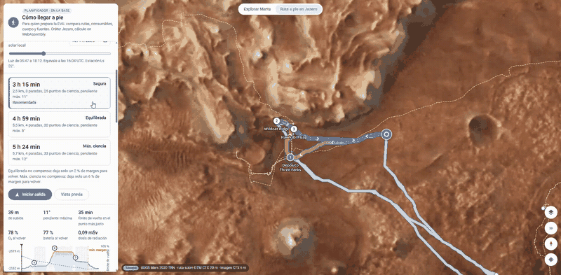
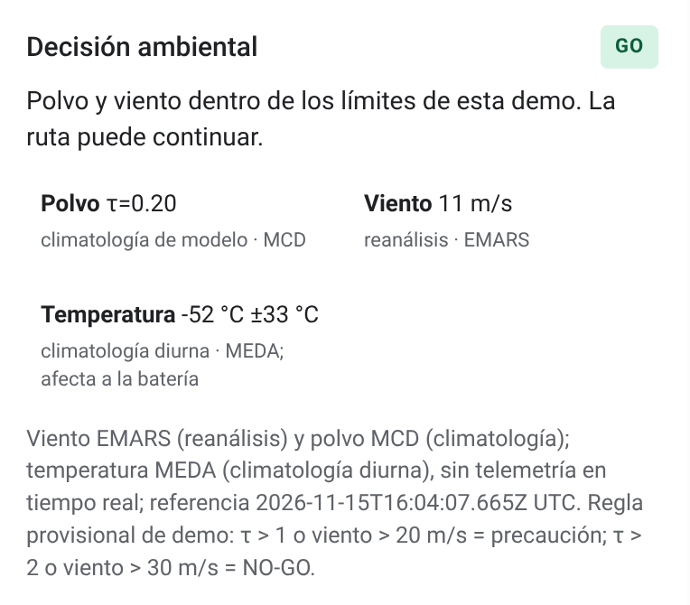
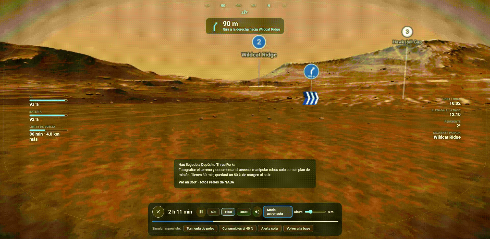
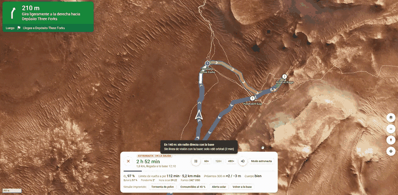
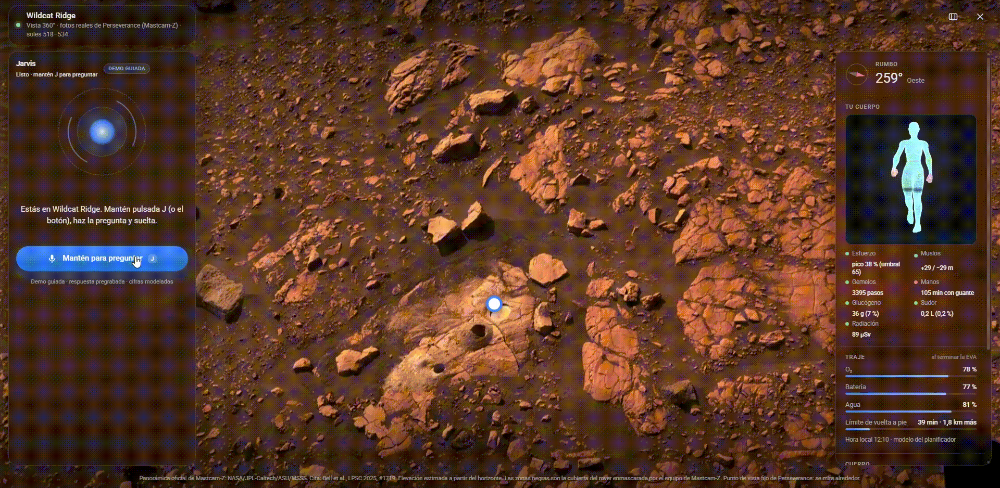

# **Marswalk**

## 🚀 Demo online

## **[Abrir Marswalk: nasa.mhanii.com](https://nasa.mhanii.com/)**




## Explorar Marte con mejores decisiones

Marswalk es una experiencia de planificación para futuras misiones humanas a Marte. Ayuda a
decidir **dónde explorar, cuándo salir, qué camino seguir y cómo reaccionar si las condiciones
cambian**.

La propuesta es sencilla: reunir en un mismo lugar la información que un equipo necesita para
convertir una idea de exploración en una misión clara, segura y explicable.

> **Marswalk es un “Google Maps para Marte” diseñado para misiones en las que no hay carreteras,
> cobertura GPS ni margen para improvisar.**

<br>

## Una pregunta para el futuro

Durante décadas, la humanidad ha imaginado convertirse en una especie interplanetaria. A medida
que ese futuro se acerca, la pregunta deja de ser solo **si podemos llegar a Marte** y pasa a ser
**cómo decidimos qué merece la pena explorar y cómo protegemos a quienes lo harán**.

Marswalk nace para ayudar a responderla.

<br>

## Nuestro reto: un mapa para la exploración humana

Marswalk participa en el **NASA Space Apps Challenge 2026**, dentro del desafío
**[Interplanetary Survival Guide: Martian Map](https://www.spaceappschallenge.org/2026/challenges/interplanetary-survival-guide-martian-map/)**.

El reto plantea una pregunta esencial: **¿cómo puede una persona explorar Marte con la mejor
información posible para llegar a sus destinos, hacer ciencia y volver a salvo?**

Nuestra respuesta es una herramienta que conecta el mapa, las condiciones del entorno, los
objetivos científicos y la seguridad de la misión en una experiencia única. En lugar de mostrar
capas aisladas, Marswalk las convierte en decisiones que un equipo puede entender y compartir.

**Equipo:** Guardians of Mars

**[Página oficial del proyecto en NASA Space Apps](https://www.spaceappschallenge.org/2026/find-a-team/guardians-of-mars/)** ·
**[Presentación del proyecto](https://docs.google.com/presentation/d/15XP5MTCN2NbjzyNW6XVtBLbdNa8CYYPmxjnSjW2Ts04/edit?usp=sharing)**

<br>

## Nuestro escenario: Jezero y Wildcat Ridge

Hemos elegido el cráter Jezero, uno de los lugares clave para preparar la exploración humana de
Marte. Hace miles de millones de años albergó un lago y un delta: un entorno especialmente
prometedor para investigar si Marte pudo reunir las condiciones necesarias para la vida.

Dentro de Jezero nos centramos en **Wildcat Ridge**, una formación rocosa de gran interés para
estudiar la habitabilidad pasada del planeta. Es el tipo de destino en el que una ruta debe
hacer algo más que llevar a una persona de un punto a otro: debe explicar por qué esa parada
merece el tiempo, el esfuerzo y el riesgo de una misión.

<br>

## El problema que resolvemos

Explorar Marte no consiste únicamente en llegar a un punto. Cada salida debe equilibrar:

- el valor científico de cada descubrimiento;
- la dificultad y el riesgo del terreno;
- el viento, el polvo, la temperatura y la luz disponible;
- el tiempo y los recursos de la persona que explora;
- la necesidad de volver siempre al hábitat.

Hoy, esta información está dispersa entre mapas, datos científicos y herramientas diferentes.
Marswalk la convierte en una experiencia visual que cualquier persona puede entender y seguir.

<br>

## No solo llegar: decidir si merece la pena ir

La mayoría de los sistemas de navegación responden a una pregunta: **¿cómo llego de A a B?**

Marswalk añade una pregunta más importante para una misión espacial:
**¿debería ir de A a B?**

La ruta más corta no siempre es la mejor misión. Marswalk pone en la misma decisión el valor
científico del destino, el estado del entorno, el esfuerzo de la astronauta y la posibilidad de
volver a salvo.

<br>

## Qué permite hacer Marswalk

### Ver el contexto completo

El globo 3D permite situarse en Marte, acercarse al cráter Jezero y consultar el relieve, el
viento, el polvo y otros factores que afectan a una salida.



Mapa topográfico:


<br>

### Elegir lugares que merecen la pena

Cada punto de interés combina ubicación, contexto científico e imágenes. Así, la ruta no solo
indica adónde ir: explica **por qué merece la pena ir**.

El equipo puede comparar distintas paradas y priorizar aquellas que aportan más valor a la
misión. En el caso de Wildcat Ridge, la información del mapa permite entender qué se espera
encontrar allí antes de invertir tiempo y recursos en llegar.




<br>

### Diseñar una misión segura

Marswalk propone un recorrido que tiene en cuenta el terreno, las zonas de riesgo, las paradas
científicas, el esfuerzo y el regreso al hábitat.

El objetivo no es dibujar una línea entre dos puntos, sino construir una misión completa:
salir, alcanzar los objetivos científicos y volver dentro de los límites previstos. De esta
forma, el equipo puede valorar las consecuencias de una ruta antes de comenzar la exploración.




Antes de comenzar, el equipo recibe una respuesta fácil de interpretar: **GO** si las
condiciones permiten iniciar la salida y **NO-GO** si el riesgo aconseja esperar o replantear
la misión. Esta decisión resume la información relevante sin obligar a interpretar múltiples
capas por separado.



<br>

### Entender la misión desde la perspectiva de la astronauta

La vista en primera persona permite experimentar el recorrido como lo viviría quien explora el
terreno. El panel de misión muestra también el impacto de la ruta en el cuerpo: oxígeno, energía,
hidratación y esfuerzo.



<br>

### Reaccionar ante lo inesperado

Si aparece una zona peligrosa, Marswalk no se limita a mostrar una alerta: ayuda a encontrar una
alternativa y hace visible el cambio de decisión.

La tripulación puede comparar el recorrido previsto con la alternativa segura y entender qué
parte de la misión cambia. Esto permite reaccionar con rapidez sin perder de vista el objetivo
científico ni el regreso al hábitat.



<br>

### Contar con un copiloto

Las películas han imaginado astronautas acompañados por una inteligencia artificial. Marswalk
lleva esa idea a un prototipo funcional: **Jarvis** acompaña la exploración y responde preguntas
sobre lo que se está observando, el estado de la misión y el valor científico de cada parada.

En lugar de obligar a buscar la información en distintos paneles, Jarvis la presenta en el
momento en que puede ser útil. Así, la astronauta recibe contexto para interpretar el terreno y
tomar decisiones con mayor autonomía, incluso cuando la comunicación con la Tierra no es
inmediata.




## Una demo de dos minutos

1. Abrir la demo online.
2. Consultar el viento, polvo, demás condiciones ambientales y puntos de interés.
3. Pulsar "Ruta a pie en Jezero"
4. Comprobar si las condiciones permiten salir.
5. Explorar la ruta desde arriba y en primera persona.
6. Ver el impacto de la misión en los recursos de la astronauta.
7. Simular un peligro y comprobar cómo cambia el recorrido.
8. Preguntar a Jarvis por la misión.


## Ciencia y confianza

Marswalk combina mapas del terreno, observaciones ambientales y referencias científicas para
construir una visión coherente de la misión. Cada parada y cada decisión están pensadas para
ser comprensibles, justificables y útiles para planificar una exploración.

El proyecto utiliza información de misiones y programas de NASA y de otras instituciones
científicas: mapas de elevación, imágenes de superficie, datos atmosféricos, polvo marciano y
panoramas de los lugares visitados por los rovers. La combinación de estas fuentes es lo que
permite pasar de un mapa bonito a una herramienta de decisión.

Para quien quiera profundizar:

- [Fuentes de datos](docs/fuentes_datos.md)
- [Planificador de rutas](docs/planificador_rutas.md)
- [Modelo del cuerpo y consumo](docs/modelo_cuerpo.md)

## Sobre el proyecto

Marswalk ha sido creado por **Guardians of Mars** para la **NASA Space Apps Challenge 2026**.

Más información sobre el hackathon en la
[web oficial de NASA Space Apps](https://www.spaceappschallenge.org/2026/) o en
[Space Apps Connect](https://github.com/nasa/spaceapps).

**Explorar más. Arriesgar menos. Volver para contarlo.**

> **Al final, lo más importante de una caminata en Marte no es el mapa. Es quien tiene que
> recorrerlo.**

## Referencia para desarrollo local

Esta sección es solo para colaboradores técnicos. Para probar el proyecto, la
[demo online](https://nasa.mhanii.com/) es la opción recomendada.

Con Python 3 instalado:

```bash
python3 -m http.server 8000
```

Después, abrir <http://localhost:8000/mapa_marte.html>.

El servidor local es necesario porque el navegador bloquea algunas cargas de datos cuando se
abre el HTML directamente desde el disco.
